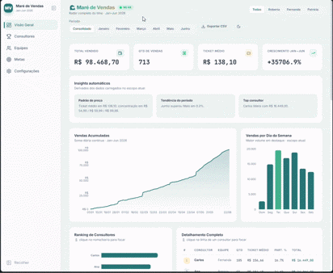

# 🌊 Maré de Vendas — Dashboard Administrativo de Vendas

<div align="center">
  <h3>📊 Painel SaaS de Gestão de Vendas — Performance Real</h3>
  
  
  

</div>

---

## 📋 Visão Geral

**Maré de Vendas** é um dashboard administrativo de vendas com aparência **SaaS premium**, construído do zero com React + Vite + Tailwind CSS v4 + Recharts. Consome dados reais de vendas (Excel → JSON) e entrega uma experiência fluida, responsiva e visualmente premium — tudo rodando 100% no frontend (sem backend necessário).

| Métrica | Valor |
|---------|-------|
| **Consultores** | 14 vendedores |
| **Equipes** | 3 supervisoras (Patricia, Fernanda, Roberta) |
| **Período** | Janeiro a Junho 2026 (6 meses) |
| **Transações** | 713 vendas |
| **Volume Total** | R$ 98.468,70 |
| **Arquitetura** | 100% Frontend (React 18 + Vite 6) |
| **Dados** | Excel (.xlsx) → JSON (pipeline Python) |

---

## ✨ Funcionalidades Principais

### 📈 Visualizações & Gráficos (7 tipos)
| Gráfico | Descrição | Animação |
|---------|-----------|----------|
| **Vendas Acumuladas** | Área com gradiente, soma diária contínua | Path draw 1.2s ease-out |
| **Ranking de Consultores** | Barras horizontais, 14 vendedores | Stagger 150ms + grow |
| **Participação por Equipe** | Donut com centro numérico | Arco 1.1s ease-out |
| **Vendas por Semana** | Barras agrupadas por mês (consolidado) / mês único | Fade + stagger |
| **Vendas por Dia da Semana** | Barras verticais, destaque melhor dia | Grow 1s ease-out |
| **Realizado por Equipe × Mês** | Barras agrupadas (todos os meses) | Staggered bars |
| **Meta vs Realizado** | Barras duplas (Meta vs Realizado) | Dual animation |

### 🎯 Interatividade Avançada
- **Cross-Filter Global** → Clique em qualquer elemento (barra, fatia, linha, dia) → **todos os gráficos e KPIs se moldam** ao item selecionado
- **Filtro de Período**: Consolidado / Janeiro / Fevereiro / Março / Abril / Maio / Junho
- **Filtro de Equipe**: Todas / Roberta / Fernanda / Patricia
- **Foco Inteligente** → Clique no mesmo item novamente para limpar o foco
- **Banner de Foco Ativo** → Indica visualmente qual item está em foco + botão "Limpar foco"

### 📊 KPIs Inteligentes (4 cards animados)
| KPI | Consolidado | Mês Individual |
|-----|-------------|----------------|
| **Total Vendido** | R$ 98.468,70 | Valor do mês |
| **Qtd de Vendas** | 713 | Qtd do mês |
| **Ticket Médio** | R$ 138,10 | Ticket do mês |
| **4º KPI Adaptativo** | Crescimento Jan→Jun (+X%) | Média Diária (R$/dia ativo) |

### 🎯 Metas por Equipe
- Barras de progresso animadas (0→100% em 900ms ease-out)
- **🟢 ≥100%** Meta atingida (mostra superávit)
- **🔵 ≥70%** No caminho certo
- **🟡 <70%** Atenção (mostra quanto falta)
- **Consolidado** = Meta mensal × meses no escopo (ex: 6 meses = meta × 6)

### 🔍 Insights Automáticos (3 cards)
- **Padrão de Preço** → Concentração em R$ 54,99 / 59,99 / 99,98
- **Tendência** → Crescimento Jan→Jun, pico em Maio, Junho volta à média
- **Top Consultor** → Líder atual com valor

### 🔧 Painel Administrativo (Oculto por Padrão)
- **Metas Editáveis** → Persistidas no localStorage (sobrescrevem data.json)
- **Toggle Animações** → Liga/desliga animações (acessibilidade/performance)
- **Toggle Tema** → Claro/Escuro (persistido no localStorage)
- **Oculto por padrão** → Só aparece ao clicar na aba "Configurações" da sidebar

### 📤 Exportação CSV Real
- Respeita filtros ativos (período + equipe)
- **Compatível Excel PT-BR** → BOM UTF-8 + separador `;` + decimal `,`
- Nome do arquivo: `mare_de_vendas_janeiro_roberta.csv`

### 🌙 Tema Claro/Escuro
- **Dark-first** (`#0B0F17` / `#121826`) + Light mode
- Persistido no `localStorage`
- Toggle no header + painel admin

### 📱 Sidebar Recolhível Responsiva
- **Desktop (≥1024px)**: Sticky, 240px ⇄ 68px (animação 300ms cubic-bezier)
- **Mobile (<1024px)**: Drawer off-canvas (slide 300ms) + backdrop blur
- **Scroll Spy** → Destaca aba ativa conforme scroll (IntersectionObserver)
- **Toggle no topo** (desktop) + Hamburger (mobile) + ESC para fechar

---

## 🧰 Stack Tecnológico

| Camada | Tecnologia | Versão | Função |
|---|---|---|---|
| Runtime JS | **Node.js** | 22.x (req. 18+) | Execução Vite + npm |
| Build Tool | **Vite** | 6.x | Dev server + Build produção |
| UI Framework | **React** | 18.x | Componentes + Estado |
| Estilização | **Tailwind CSS** | 4.x | Design tokens, Dark/Light, JIT |
| Gráficos | **Recharts** | 2.15.x | Área, Barras, Donut, Tooltips |
| Ícones | **lucide-react** | 0.469.x | Sidebar, Header, UI |
| Fontes | **Inter** + **JetBrains Mono** | Google Fonts | UI + Números tabulares |
| Pipeline Dados | **Python** | 3.11 | Excel → JSON |
| Parser Excel | **openpyxl** | 3.1+ | Leitura `.xlsx` |

---

## 🐍 Pipeline de Dados (Python) — `dashboads01/.venv`

> O ambiente Python **só é necessário para atualizar dados**. O dashboard roda 100% com Node.

### 1. Ativar `.venv`
```powershell
# PowerShell
cd "C:\Users\lcost\Documents\Codigos\Projetos lv1\dashboads01"
.\.venv\Scripts\Activate.ps1

# CMD
cd "C:\Users\lcost\Documents\Codigos\Projetos lv1\dashboads01"
.venv\Scripts\activate.bat
```
> Se PowerShell bloquear: `Set-ExecutionPolicy -Scope CurrentUser RemoteSigned`

### 2. Instalar dependências (uma vez)
```powershell
pip install -r requirements.txt  # openpyxl
```

### 3. Atualizar dados (Excel → JSON)
```powershell
python atualizar_dados.py
```
**Saída esperada:**
```
Lido do Excel: 14 consultores, 713 vendas
  2026-01: R$ 13.250,00 (95 transações)
  2026-02: R$ 14.550,00 (100 transações)
  2026-03: R$ 16.100,00 (105 transações)
  2026-04: R$ 18.510,00 (110 transações)
  2026-05: R$ 22.776,09 (180 transações)
  2026-06: R$ 13.282,61 (123 transações)
✅ data.json atualizado
```
> O script preserva metas editadas manualmente no `data.json`.

---

## 🚀 Quick Start

```bash
# 1. Instalar dependências
cd salespulse
npm install

# 2. Rodar em desenvolvimento
npm run dev
# Abre em http://localhost:5173

# 3. (Opcional) Atualizar dados do Excel
cd ..
.\.venv\Scripts\Activate.ps1
python atualizar_dados.py
```

---

## 🚀 Como Rodar o Dashboard

```powershell
cd "C:\Users\lcost\Documents\Codigos\Projetos lv1\dashboads01\salespulse"
npm install          # primeira vez
npm run dev          # desenvolvimento → http://localhost:5173
npm run build        # produção → dist/
npm run preview      # serve build de produção
```

### Requisitos
- **Node.js ≥ 18** (recomendado 22+)
- **npm ≥ 9**
- Porta **5173** livre (ou use `--port 3000`)

---

## 🖥️ Guia da Interface

### Header (Topo)
| Elemento | Ação |
|----------|------|
| **🌊 Maré de Vendas** | Título + badge "NO AR" pulsante |
| **Chips de Equipe** | Todas / Roberta / Fernanda / Patrícia |
| **Chips de Período** | Consolidado / Janeiro / Fevereiro / Março / Abril / Maio / Junho |
| **Exportar CSV** | Baixa CSV filtrado (PT-BR) |
| **🌙/☀️** | Toggle Tema (persistido) |

### Sidebar (Navegação)
| Item | Âncora | Descrição |
|------|--------|-----------|
| **Visão Geral** | `#visao` | KPIs + Acumulado + Dia da Semana |
| **Consultores** | `#ranking` | Ranking (esq) + Detalhamento (dir) |
| **Equipes** | `#equipes` | Participação + Semanas + Realizado × Mês |
| **Metas** | `#metas` | Progresso + Meta vs Realizado + Insights |
| **Configurações** | `#config` | **Painel Admin** (Metas, Animações, Tema) |

### Aba "Consultores" — Layout Duplo (5/12 + 7/12)
| Painel | Altura | Conteúdo |
|--------|--------|----------|
| **Ranking de Consultores** | 780px | Barras horizontais 14 vendedores, clicáveis |
| **Detalhamento Completo** | 780px | Tabela 14 linhas: #, Consultor, Equipe, Qtd, Ticket, Part.%, Total |

### Aba "Equipes" — 3 Gráficos
| Gráfico | Descrição |
|---------|-----------|
| **Participação por Equipe** | Donut centralizado (3 equipes) |
| **Vendas por Semana** | Barras agrupadas por mês (consolidado) / semanas do mês |
| **Realizado por Equipe** | Barras agrupadas por mês (todos os meses) |

### Aba "Metas" — Progresso + Comparativo
| Painel | Descrição |
|--------|-----------|
| **Metas por Equipe** | Barras de progresso animadas (0→100%) |
| **Meta vs Realizado** | Barras duplas (Meta cinza vs Realizado colorido) |
| **Insights** | 3 cards: Padrão de Preço, Tendência, Top Consultor |

### Aba "Configurações" (Painel Admin)
| Seção | Controles |
|-------|-----------|
| **Metas por Equipe** | Input numérico (R$) + "Salvar metas" + "Restaurar padrão" |
| **Preferências** | Toggle Animações (on/off) + Toggle Tema (Claro/Escuro) |
| **Debug Panel** | Dados brutos: Métricas, Série, Dias Semana, Equipes×Mês, Filtros ativos |

---

## 📂 Estrutura do Projeto

```
dashboads01/
├── .venv/                          # Python virtualenv
├── requirements.txt                # openpyxl
├── atualizar_dados.py              # Excel → JSON (preserva metas)
├── colocar_nomes_equipes.py        # Script: equipes A/B/C → nomes reais
├── colocar_nomes_simples.py        # Script: nomes completos → primeiros nomes
├── debug_ranking.py                # Debug: valida ranking esperado
├── sync_json_from_excel.py         # Sync: Excel consolidado → JSON
├── PowerBI_Vendas_*.xlsx           # Dados fonte (originais)
├── Maré de Vendas_Jan_Jun_2026.xlsx # Excel consolidado (6 meses)
└── salespulse/                      # Dashboard React
    ├── index.html                   # Fonts + favicon + meta
    ├── vite.config.js               # Vite + React + Tailwind v4
    ├── package.json
    ├── README.md                    # Este arquivo
    └── src/
        ├── data.json                # ⭐ Dados + metas (gerado pelo pipeline)
        ├── main.jsx                 # Entry point React
        ├── App.jsx                  # Layout, filtros, temas, métricas, roteamento
        ├── index.css                # Tokens Tailwind, skeletons, animações
        ├── components/
        │   ├── Sidebar.jsx          # Navegação recolhível + drawer mobile
        │   ├── Header.jsx           # Filtros, tema, exportar
        │   ├── KpiRow.jsx           # 4 KPIs + CountUp + skeletons
        │   ├── Charts.jsx           # 7 gráficos Recharts + tooltips
        │   ├── MetasPanel.jsx       # Barras progresso animadas
        │   ├── SettingsPanel.jsx    # Admin: metas, animações, tema
        │   └── RankingTable.jsx     # Tabela detalhamento (14 linhas)
        ├── lib/hooks.js             # useCountUp + formatadores BRL
        └── utils/exportCsv.js       # Export CSV real (PT-BR)
```

---

## 📊 Formato do `data.json`

```jsonc
{
  "consultores": [
    { "id": 1, "nome": "Ana", "equipe": "Patricia" },
    { "id": 2, "nome": "Joao", "equipe": "Patricia" },
    ...
  ],
  "vendas": [
    { "data": "2026-01-01", "consultorId": 6, "valor": 139.97 },
    ...
  ],
  "metas": { "Patricia": 5200, "Fernanda": 5000, "Roberta": 5000 }
}
```
> **Metas** = valor **mensal** (em R$). Em `Consolidado`, multiplica automaticamente pelos meses no escopo.

---

## 🎨 Design System (Tokens)

| Token | Dark Mode | Light Mode |
|-------|-----------|------------|
| **Background** | `#0B0F17` | `#F6F7FB` |
| **Card** | `#121826` | `#FFFFFF` |
| **Border** | `rgba(255,255,255,0.06)` | `rgba(15,23,42,0.08)` |
| **Primary** | `#6366F1` (Indigo) | `#6366F1` |
| **Success** | `#22C55E` | `#22C55E` |
| **Warning** | `#F59E0B` | `#F59E0B` |
| **Bronze (Accent)** | `#B08D57` | `#B08D57` |
| **Text Primary** | `#E8EEF0` | `#0F172A` |
| **Text Muted** | `#94A3B8` | `#64748B` |

| Token | Valor |
|---|---|
| **Border Radius** | 14px (cards), 8px (inputs), 9999px (pills) |
| **Border Width** | 1px |
| **Shadow** | Apenas em cards de destaque (KPI principal) |
| **Font UI** | Inter (400/500/600/700/800) |
| **Font Numbers** | JetBrains Mono (`.tnum` → `font-variant-numeric: tabular-nums`) |
| **Spacing Scale** | 4/8/12/16/24/32/40/48/64 |

---

## 🧩 Resolução de Problemas

| Sintoma | Causa | Solução |
|---------|-------|---------|
| `npm run dev` falha | Node < 18 ou `npm install` não rodado | `node -v` ≥ 18 + `npm install` |
| Porta 5173 ocupada | Outro processo na porta | `npm run dev -- --port 3000` |
| PowerShell bloqueia `Activate.ps1` | ExecutionPolicy restrita | `Set-ExecutionPolicy -Scope CurrentUser RemoteSigned` |
| Prompt sem `(.venv)` | Venv não ativado | `.\.venv\Scripts\Activate.ps1` |
| CSV abre errado no Excel | Encoding UTF-8 sem BOM | Arquivo já tem BOM — use *Dados → De Texto* → UTF-8 |
| Dados desatualizados | `data.json` desatualizado | Ative `.venv` → `python atualizar_dados.py` |
| Gráfico em branco ao filtrar | Nomes de equipe diferentes (Header vs data.json) | Use nomes **idênticos** no Header e `data.json` (ex: "Patricia" em ambos) |
| Tabela cortada (11/14 linhas) | Altura fixa + sem scroll | `h-full overflow-y-auto` + fonte/padding compactos |
| Ranking cortado | Container menor que gráfico | Ajuste `h-[XXXpx]` no Painel + `margin` no BarChart |
| Tabela cortada (11/14 linhas) | Altura fixa + sem scroll | `h-full overflow-y-auto` + fonte/padding compactos |

---

## 🗺️ Roadmap

- [x] **Nomes reais das equipes** (Header + dados sincronizados)
- [x] **Nomes simples** (primeiros nomes brasileiros)
- [x] **Cross-filter global** (clique em qualquer elemento → foco)
- [x] **Metas editáveis** (localStorage + sobrescreve data.json)
- [x] **Debug Panel** na aba Configurações
- [x] **Ranking = Detalhamento** mesma altura (780px)
- [x] **Detalhamento Completo** mostra todos 14 vendedores
- [x] **Ranking de Consultores** altura igual ao detalhamento (780px)
- [ ] Gráfico "Meta vs Realizado" por mês individual
- [ ] Deploy automatizado (Vercel/Netlify + GitHub Actions)
- [ ] Code-splitting (lazy load Charts.jsx, MetasPanel.jsx)
- [ ] PWA (Service Worker + Manifest)
- [ ] Testes automatizados (Vitest + Playwright)

---

**Fora do escopo** (trabalho extra): Backend real, Auth/SSO, Dados real-time (WebSocket), Alertas (e-mail/Slack), Multi-tenancy, RBAC.

---

## 📄 Licença

Uso interno — Projeto **Maré de Vendas** para demonstração e uso administrativo.

---

> **Última atualização**: 18/10/2026 | Versão 1.3.0 | Build: ✅ Passing
